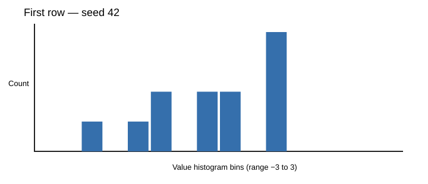
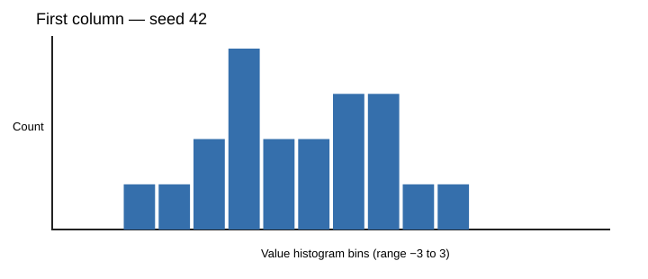

# Lab 1 — Histograms for random matrix statistics

The task requires histograms of the row and column values. The figures below use `matrix_statistics(RandomMatrixInput(rows=20, columns=12, mean=0, std=1, seed=42))`. The same seeded matrix is reproduced by `python plot_histograms.py`, which saves more detailed `histogram_rows.png` and `histogram_columns.png` plots with Matplotlib `pyplot.hist`.

## Example row distribution


## Example column distribution


Both examples use 16 bins over the range [−3, 3]. The main plotting script also generates histograms for **every** row and **every** column with `plt.hist`; these examples are included for direct viewing in GitHub without executing Python.

## Run
```bash
python -m pip install numpy matplotlib pytest
python plot_histograms.py
python -m pytest -q
```
